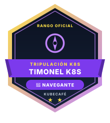
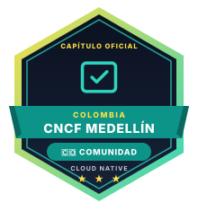
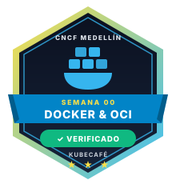
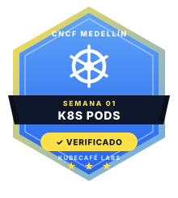
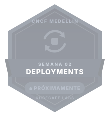
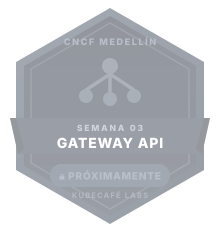
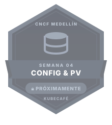
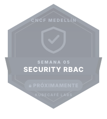
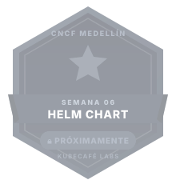

<div align="center">

# 🎓 Portafolio Profesional Cloud Native & Kubernetes

<br/>

### Yorman Agudelo (`@Cuburi`)
**Fullstack Developer**

*«Aprovechar al maximo esta oportunidad de aprender»*

[](https://github.com/Cuburi) [](https://www.linkedin.com/in/yorman-agudelo/)

---

### 🎖️ Rango Verificado e Insignias Oficiales (CI/CD)

<table>
  <tr>
    <td align="center" width="165">
      <a href="https://github.com/edwinbermudez91/Fundamentos-Kubernetes/blob/main/ASISTENTES.md" title="Rango Oficial: 🧭 Timonel">
        
      </a>
    </td>
    <td align="center" width="140">
      <sub>⚡ <b>PUNTAJE TOTAL</b></sub><br/>
      <h3><code>100 XP</code></h3>
      <sub>Verificado CI/CD</sub>
    </td>
    <td align="center" width="140">
      <sub>🛠️ <b>RETOS RESUELTOS</b></sub><br/>
      <h3><code>9</code></h3>
      <sub>Troubleshooting</sub>
    </td>
    <td align="center" width="140">
      <sub>✍️ <b>BITÁCORAS</b></sub><br/>
      <h3><code>0</code></h3>
      <sub><a href="#-bitácoras-de-reflexión-e-ingeniería">Ver notas</a></sub>
    </td>
    <td align="center" width="165">
      <a href="https://ocgroups.dev/cncf/group/2majk4r" title="Capítulo Oficial CNCF Medellín">
        
      </a>
    </td>
  </tr>
</table>

</div>

---

## 🧩 Mapa de Competencias e Insignias por Módulo

<div align="center">

<a href="./semana-00" title="🐳 Semana 00: Fundamentos de Docker (De Código a Contenedor)"></a>
<a href="./semana-01" title="🌱 Semana 01: Arquitectura de Kubernetes y Pods"></a>
<a href="#-evidencias-técnicas-y-laboratorios-resueltos-en--kubecafé" title="🔄 Semana 02: Deployments, Réplicas y Autorreparación"></a>
<a href="#-evidencias-técnicas-y-laboratorios-resueltos-en--kubecafé" title="🌐 Semana 03: Redes en Kubernetes (Services y Gateway API)"></a>
<a href="#-evidencias-técnicas-y-laboratorios-resueltos-en--kubecafé" title="💾 Semana 04: Configuración y Datos Persistentes"></a>
<a href="#-evidencias-técnicas-y-laboratorios-resueltos-en--kubecafé" title="🛡️ Semana 05: Salud, Límites y Seguridad (RBAC)"></a>
<a href="#-evidencias-técnicas-y-laboratorios-resueltos-en--kubecafé" title="🎓 Semana 06: Empaquetado con Helm y Proyecto Final KubeCafé"></a>

</div>

---

## 📊 Evidencias Técnicas y Laboratorios Resueltos en ☕ KubeCafé

Cada entrega en este portafolio es validada automáticamente por el motor de integración continua de [**De Cero a Capitán en Kubernetes — Cloud Native Medellín (CNCF)**](https://github.com/edwinbermudez91/Fundamentos-Kubernetes) frente a escenarios reales de resolución de fallos (*Troubleshooting*):

| Módulo & Habilidades Practicadas | Progreso | Evidencias | Bitácora (+10 XP) |
| :--- | :---: | :---: | :---: |
| **🐳 Semana 00: Fundamentos de Docker (De Código a Contenedor)**<br/><sub>Dockerfile, imágenes OCI, seguridad rootless, .dockerignore y redes en contenedores</sub> | 🟩🟩🟩🟩🟩<br/><sub>✅ <b>5/5</b> · <code>+50 XP</code></sub> | [📂 Código](./semana-00) | [➕ Crear](https://github.com/edwinbermudez91/Fundamentos-Kubernetes/issues/new?template=bitacora-semanal.yml&github_user=Cuburi&semana=semana-00+%E2%80%94+%F0%9F%90%B3+Fundamentos+de+Docker+%28De+C%C3%B3digo+a+Contenedor%29) |
| **🌱 Semana 01: Arquitectura de Kubernetes y Pods**<br/><sub>Control Plane, Worker Nodes, kubectl, diagnóstico de Pods (ImagePullBackOff, CrashLoopBackOff, Pending)</sub> | 🟩🟩🟩🟩🟩<br/><sub>✅ <b>4/4</b> · <code>+40 XP</code></sub> | [📂 Código](./semana-01) | [➕ Crear](https://github.com/edwinbermudez91/Fundamentos-Kubernetes/issues/new?template=bitacora-semanal.yml&github_user=Cuburi&semana=semana-01+%E2%80%94+%F0%9F%8C%B1+Arquitectura+de+Kubernetes+y+Pods) |
| **🔄 Semana 02: Deployments, Réplicas y Autorreparación**<br/><sub>ReplicaSets, Deployments, Self-Healing, Rolling Updates con cero caídas y Rollbacks</sub> | ⬜⬜⬜⬜⬜<br/><sub>⚪ Pendiente</sub> | — | [➕ Crear](https://github.com/edwinbermudez91/Fundamentos-Kubernetes/issues/new?template=bitacora-semanal.yml&github_user=Cuburi&semana=semana-02+%E2%80%94+%F0%9F%94%84+Deployments%2C+R%C3%A9plicas+y+Autorreparaci%C3%B3n) |
| **🌐 Semana 03: Redes en Kubernetes (Services y Gateway API)**<br/><sub>ClusterIP, NodePort, CoreDNS y enrutamiento HTTP moderno con Gateway API (Gateway y HTTPRoute)</sub> | ⬜⬜⬜⬜⬜<br/><sub>⚪ Pendiente</sub> | — | [➕ Crear](https://github.com/edwinbermudez91/Fundamentos-Kubernetes/issues/new?template=bitacora-semanal.yml&github_user=Cuburi&semana=semana-03+%E2%80%94+%F0%9F%8C%90+Redes+en+K8s%3A+Services+y+Gateway+API) |
| **💾 Semana 04: Configuración y Datos Persistentes**<br/><sub>ConfigMaps, Secrets, PersistentVolumes (PV) y PersistentVolumeClaims (PVC)</sub> | ⬜⬜⬜⬜⬜<br/><sub>⚪ Pendiente</sub> | — | [➕ Crear](https://github.com/edwinbermudez91/Fundamentos-Kubernetes/issues/new?template=bitacora-semanal.yml&github_user=Cuburi&semana=semana-04+%E2%80%94+%F0%9F%92%BE+Configuraci%C3%B3n+y+Datos+Persistentes+%28ConfigMaps%2C+Secrets%2C+PV%29) |
| **🛡️ Semana 05: Salud, Límites y Seguridad (RBAC)**<br/><sub>Liveness/Readiness Probes, Resource Requests/Limits y control de acceso RBAC</sub> | ⬜⬜⬜⬜⬜<br/><sub>⚪ Pendiente</sub> | — | [➕ Crear](https://github.com/edwinbermudez91/Fundamentos-Kubernetes/issues/new?template=bitacora-semanal.yml&github_user=Cuburi&semana=semana-05+%E2%80%94+%F0%9F%9B%A1%EF%B8%8F+Salud%2C+L%C3%ADmites+y+Seguridad+%28Probes%2C+Quotas%2C+RBAC%29) |
| **🎓 Semana 06: Empaquetado con Helm y Proyecto Final KubeCafé**<br/><sub>Helm Charts, plantillas parametrizadas y despliegue multicapa de alta disponibilidad</sub> | ⬜⬜⬜⬜⬜<br/><sub>⚪ Pendiente</sub> | — | [➕ Crear](https://github.com/edwinbermudez91/Fundamentos-Kubernetes/issues/new?template=bitacora-semanal.yml&github_user=Cuburi&semana=semana-06+%E2%80%94+%F0%9F%8E%93+Empaquetado+con+Helm+y+Proyecto+Final+KubeCaf%C3%A9) |

---

## 📔 Bitácoras de Reflexión e Ingeniería

<div align="left">

> 💡 *¡Suma **+10 XP Bonus** por semana! Haz clic en **[📔 Registrar mi Bitácora de Aprendizaje en 20 segundos](https://github.com/edwinbermudez91/Fundamentos-Kubernetes/issues/new?template=bitacora-semanal.yml&github_user=Cuburi&semana=semana-00+%E2%80%94+%F0%9F%90%B3+Fundamentos+de+Docker+%28De+C%C3%B3digo+a+Contenedor%29)** para documentar lo que aprendiste y obtener un post personalizado para LinkedIn.*

</div>

<div align="center">

[-2ea44f?style=for-the-badge&logo=github)](https://github.com/edwinbermudez91/Fundamentos-Kubernetes/issues/new?template=bitacora-semanal.yml)

</div>

---

## 📣 Comparte tu Portafolio Profesional en Redes Sociales

Publica tus avances prácticos y tu progreso verificado por CI/CD ante reclutadores, líderes técnicos y la comunidad Cloud Native.

---

### 🚀 Publicar en LinkedIn (Recomendado para Reclutadores)

> [!TIP]
> **¿Por qué copiar el texto y adjuntar imagen en LinkedIn?**  
> 1. **Espaciado protegido:** El bloque de texto ya incluye separadores invisibles (`U+2800`) para que el editor de LinkedIn **no comprima ni junte todo el texto** en un solo párrafo al pegar.  
> 2. **Mayor visibilidad profesional:** Las publicaciones nativas en LinkedIn con **texto + imagen propia (captura de pantalla)** tienen **hasta 10 veces más alcance e interacción** en el feed que compartir un enlace suelto (el cual además arroja *"Cannot display preview"* en carpetas de GitHub).

Sigue estos **3 sencillos pasos**:

1. **Copia el texto pre-armado** (haz clic en el ícono de copiar en la esquina superior derecha del bloque de código):
```text
☸️ ¡Sigo construyendo mi Portafolio Práctico de Docker y Kubernetes en el workshop "De Cero a Capitán en Kubernetes" con la comunidad Cloud Native Medellín (CNCF)! 🏔️☕
⠀
🎖️ Rango actual: 🧭 Timonel (100 XP)
⠀
📂 Mi Portafolio de Laboratorios y Bitácora verificada:
https://github.com/edwinbermudez91/Fundamentos-Kubernetes/tree/main/aportes-comunidad/soluciones-retos/Cuburi
⠀
Agradecimientos a Cloud Native Colombia (Armenia, Bogota, Cali, Medellin) por este espacio de formación abierta:
⠀
🏢 LinkedIn: https://www.linkedin.com/company/cloud-native-colombia/
⠀
📸 Instagram: https://www.instagram.com/colombiacloudnative/
⠀
▶️ YouTube: https://www.youtube.com/@CloudNativeColombia
⠀
🔗 Capítulo oficial CNCF: https://ocgroups.dev/cncf/group/2majk4r
⠀
#Kubernetes #Docker #CloudNative #DevOps #KubeCafe #CNCFMedellin #OpenSource
```

2. **Toma una captura de pantalla** de la cabecera de tu portafolio (donde se ven tu foto, tu rango **🧭 Timonel**, tus **100 XP** y las insignias de tus retos resueltos).
3. **Abre el creador de publicaciones de LinkedIn:** Haz clic en el botón de abajo, pega el texto (`Ctrl+V` / `Cmd+V`) y adjunta tu captura de pantalla:

<div align="center">

[](https://www.linkedin.com/feed/?shareActive=true)

</div>

---

### 🌐 Compartir en otras Redes y Canales Oficiales

En WhatsApp y Telegram el mensaje y enlace a tu portafolio se cargan automáticamente en 1 solo clic:

<div align="center">

[](https://api.whatsapp.com/send?text=%E2%98%B8%EF%B8%8F%20%C2%A1Sigo%20construyendo%20mi%20Portafolio%20Pr%C3%A1ctico%20de%20Docker%20y%20Kubernetes%20en%20el%20workshop%20%22De%20Cero%20a%20Capit%C3%A1n%20en%20Kubernetes%22%20con%20la%20comunidad%20Cloud%20Native%20Medell%C3%ADn%20(CNCF)!%20%F0%9F%8F%94%EF%B8%8F%E2%98%95%0A%E2%A0%80%0A%F0%9F%8E%96%EF%B8%8F%20Rango%20actual%3A%20%F0%9F%A7%AD%20Timonel%20(100%20XP)%0A%E2%A0%80%0A%F0%9F%93%82%20Mi%20Portafolio%20de%20Laboratorios%20y%20Bit%C3%A1cora%20verificada%3A%0Ahttps%3A%2F%2Fgithub.com%2Fedwinbermudez91%2FFundamentos-Kubernetes%2Ftree%2Fmain%2Faportes-comunidad%2Fsoluciones-retos%2FCuburi%0A%E2%A0%80%0AAgradecimientos%20a%20Cloud%20Native%20Colombia%20(Armenia%2C%20Bogota%2C%20Cali%2C%20Medellin)%20por%20este%20espacio%20de%20formaci%C3%B3n%20abierta%3A%0A%E2%A0%80%0A%F0%9F%8F%A2%20LinkedIn%3A%20https%3A%2F%2Fwww.linkedin.com%2Fcompany%2Fcloud-native-colombia%2F%0A%E2%A0%80%0A%F0%9F%93%B8%20Instagram%3A%20https%3A%2F%2Fwww.instagram.com%2Fcolombiacloudnative%2F%0A%E2%A0%80%0A%E2%96%B6%EF%B8%8F%20YouTube%3A%20https%3A%2F%2Fwww.youtube.com%2F%40CloudNativeColombia%0A%E2%A0%80%0A%F0%9F%94%97%20Cap%C3%ADtulo%20oficial%20CNCF%3A%20https%3A%2F%2Focgroups.dev%2Fcncf%2Fgroup%2F2majk4r%0A%E2%A0%80%0A%23Kubernetes%20%23Docker%20%23CloudNative%20%23DevOps%20%23KubeCafe%20%23CNCFMedellin%20%23OpenSource)
[](https://t.me/share/url?url=https%3A%2F%2Fgithub.com%2Fedwinbermudez91%2FFundamentos-Kubernetes%2Ftree%2Fmain%2Faportes-comunidad%2Fsoluciones-retos%2FCuburi&text=%E2%98%B8%EF%B8%8F%20Mi%20Portafolio%20Pr%C3%A1ctico%20de%20Docker%20y%20Kubernetes%20en%20Cloud%20Native%20Medell%C3%ADn%20(%F0%9F%A7%AD%20Timonel%20%E2%80%A2%20100%20XP)%20%F0%9F%8F%94%EF%B8%8F%E2%98%95)
[](https://www.instagram.com/colombiacloudnative/)
[](https://www.youtube.com/@CloudNativeColombia)
[](https://www.linkedin.com/company/cloud-native-colombia/)

</div>

---

### 🎖️ Insignia Dinámica para tu Perfil de GitHub (`github.com/Cuburi/Cuburi`)

Pega esta línea en el `README.md` de tu perfil personal de GitHub para mostrar tu rango oficial y enlazar directamente a este portafolio verificado:

```markdown
[-7c3aed?style=for-the-badge&logo=kubernetes&logoColor=white)](https://github.com/edwinbermudez91/Fundamentos-Kubernetes/tree/main/aportes-comunidad/soluciones-retos/Cuburi)
```

---

<div align="center">
  <sub>🏔️☕ Portafolio generado y verificado automáticamente por <b><a href="https://github.com/edwinbermudez91/Fundamentos-Kubernetes">Cloud Native Medellín (CNCF) — De Cero a Capitán en Kubernetes</a></b></sub>
</div>
