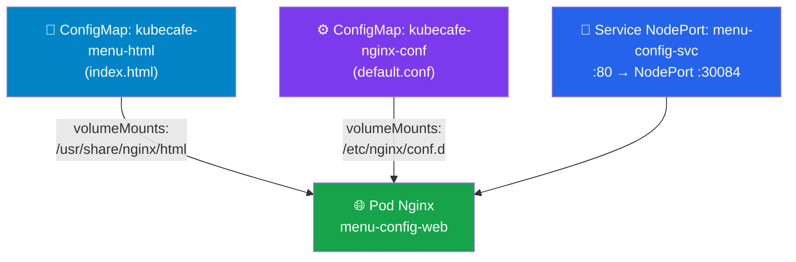
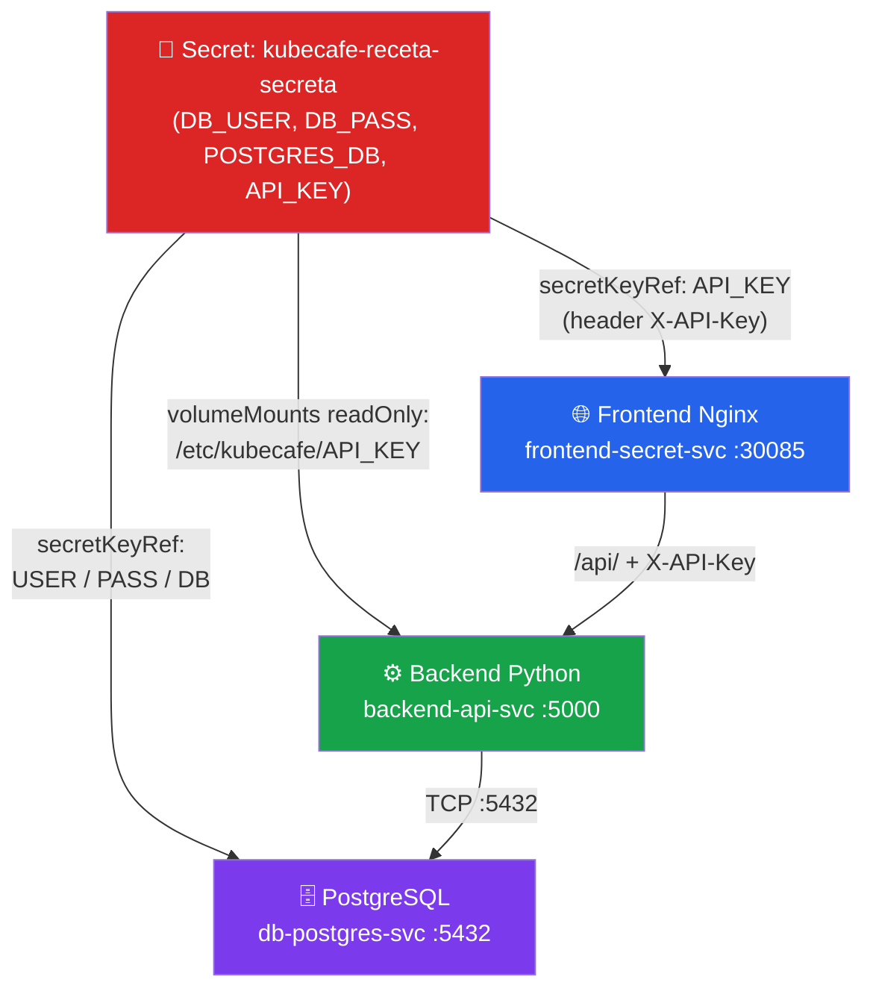
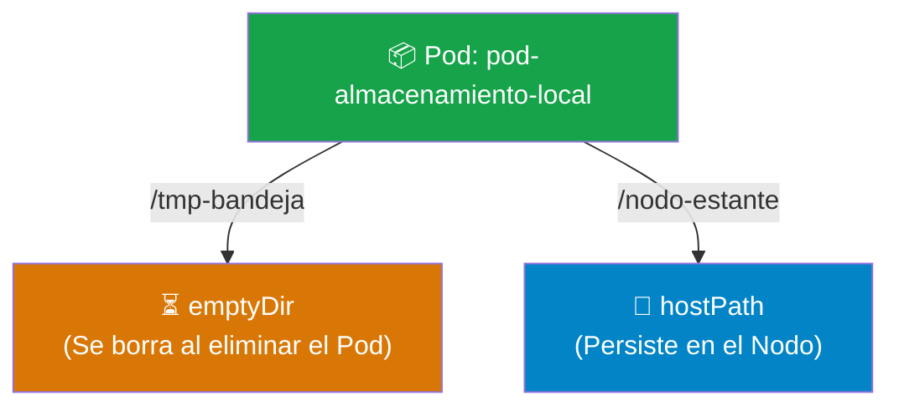
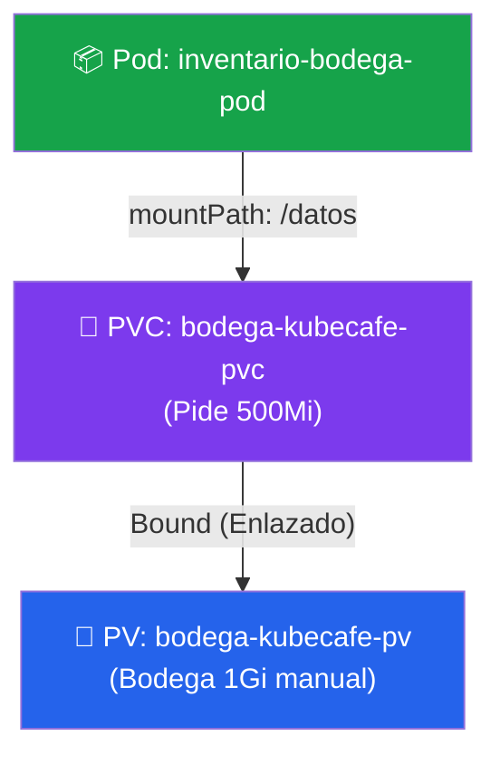
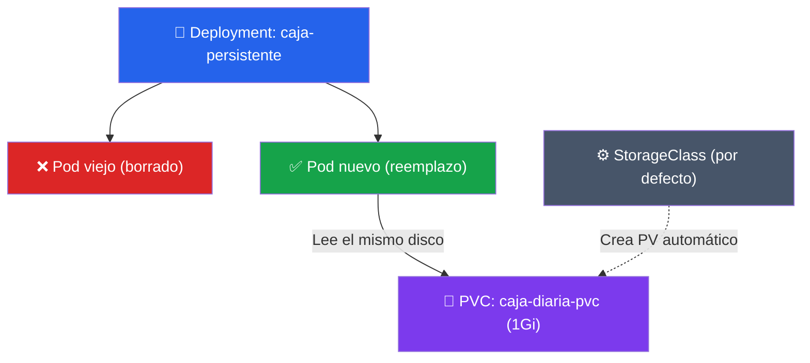

# 🧪 Ejemplos Prácticos de la Semana 04: ConfigMaps, Secrets y Almacenamiento

¡Bienvenido a los laboratorios de la **Semana 04**!  
Esta guía está pensada paso a paso para que cualquier persona —incluso si es tu primera vez con Kubernetes— entienda **qué hace cada comando**, **qué debería responder la terminal** y **por qué ocurre**.

---

## 📦 Paso 0: Prepara tu Entorno (Clonar y Ruta de Trabajo)

Todos los comandos de esta semana se ejecutan desde la **raíz del repositorio (`Fundamentos-Kubernetes`)**:

```bash
# 1. Clonar el repositorio oficial (si aún no lo tienes)
git clone https://github.com/edwinbermudez91/Fundamentos-Kubernetes.git 2>/dev/null || true

# 2. Entrar a la raíz del repositorio y traer los últimos cambios
cd Fundamentos-Kubernetes
git pull origin main
```

---

## 📑 Índice de Ejemplos

| Manifiesto | Concepto Clave | Equivalente en ☕ KubeCafé |
| :--- | :--- | :--- |
| [`01-configmap-variables-entorno.yaml`](./01-configmap-variables-entorno.yaml) | `ConfigMap` con `envFrom` | Tablero de precios inyectado al barista al abrir turno. |
| [`02-configmap-volumen-archivo.yaml`](./02-configmap-volumen-archivo.yaml) | `ConfigMap` montado como archivo | Carta HTML colgada en Nginx sin reconstruir la imagen. |
| [`03-secret-credenciales.yaml`](./03-secret-credenciales.yaml) | `Secret` (`env` + volumen `readOnly`) | Clave de caja fuerte y API Key en bóveda protegida. |
| [`04-volumen-emptydir-vs-hostpath.yaml`](./04-volumen-emptydir-vs-hostpath.yaml) | `emptyDir` vs `hostPath` | Bandeja temporal en barra vs estante fijo del nodo. |
| [`05-pv-pvc-paso-a-paso.yaml`](./05-pv-pvc-paso-a-paso.yaml) | `PV` (`Available`) ➔ `PVC` (`Bound`) ➔ Persistencia entre Pods | Un Pod guarda un archivo, muere, y otro Pod distinto lo lee intacto. |
| [`06-pv-pvc-almacenamiento-persistente.yaml`](./06-pv-pvc-almacenamiento-persistente.yaml) | `PV` + `PVC` (`manual`) | Bodega física (`PV`) reservada mediante contrato (`PVC`). |
| [`07-storageclass-dinamico-stateful.yaml`](./07-storageclass-dinamico-stateful.yaml) | `PVC` dinámico + `Deployment` | Caja registradora cuyos registros sobreviven al borrar el Pod. |
| [`08-statefulset-mysql-headless-app.yaml`](./08-statefulset-mysql-headless-app.yaml) | `StatefulSet` (MySQL) + `Headless Service` + Backend + Frontend | Bóveda de base de datos con nombre fijo (`mysql-0`), disco propio y app completa. |

---

## 🧂 Laboratorio 1: `ConfigMap` como Variables de Entorno

### 💡 ¿Qué aprenderás?
En lugar de escribir configuraciones fijas dentro del código o la imagen Docker (como el precio del tinto o la moneda), las guardamos aparte en un **`ConfigMap`** y se las pasamos al contenedor como **variables de entorno** (`envFrom`).

### Paso 1: Aplica el manifiesto y espera a que el Pod arranque
```bash
kubectl apply -f semana-04-configuracion-almacenamiento/1.ejemplos/01-configmap-variables-entorno.yaml
kubectl wait --for=condition=ready pod/barista-config-env --timeout=60s
```
> 💡 **Respuesta esperada:**
> ```text
> configmap/kubecafe-config created
> pod/barista-config-env created
> pod/barista-config-env condition met
> ```

### Paso 2: Lista y accede al contenido del `ConfigMap`
```bash
# Listar todos los ConfigMaps del namespace (forma corta: cm)
kubectl get configmaps
kubectl get cm

# Ver detalles y claves del ConfigMap
kubectl describe configmap kubecafe-config

# Acceder al contenido completo en formato YAML
kubectl get configmap kubecafe-config -o yaml
```
> 💡 **Respuesta esperada (`describe` / `-o yaml`):** Verás las 4 claves definidas en `data`: `NOMBRE_LOCAL`, `MONEDA`, `PRECIO_TINTO` y `MODO_DEBUG`.

### Paso 3: Inspecciona el Pod con `describe`, `logs` y `exec`
```bash
# 1. Ver en el Pod que las variables están conectadas al ConfigMap
kubectl describe pod barista-config-env

# 2. Ver la salida impresa al iniciar el contenedor
kubectl logs barista-config-env

# 3. Validar las variables directamente dentro del contenedor con exec
kubectl exec barista-config-env -- env | grep -E "NOMBRE_LOCAL|MONEDA|PRECIO_TINTO|MODO_DEBUG"

# (Opcional) Entrar en modo interactivo al contenedor y consultarlas manualmente
kubectl exec -it barista-config-env -- sh
# Dentro del Pod ejecuta: echo "$NOMBRE_LOCAL | $MONEDA | $PRECIO_TINTO" && exit
```
> 💡 **Respuesta esperada:**
> - En `kubectl describe pod barista-config-env` verás la sección `Environment Variables from: kubecafe-config ConfigMap`.
> - En `kubectl logs` y `kubectl exec` confirmarás los valores reales dentro del contenedor:
> ```text
> NOMBRE_LOCAL=KubeCafé Medellín
> MONEDA=COP
> PRECIO_TINTO=3500
> MODO_DEBUG=false
> ```

---

## 📄 Laboratorio 2: `ConfigMap` para Web HTML, Config de Nginx y `NodePort`

### 💡 ¿Qué aprenderás?
Un `ConfigMap` también puede montarse como **archivos reales** dentro del contenedor (`volumeMounts`). Aquí usamos **dos ConfigMaps** sin reconstruir la imagen:
- `kubecafe-menu-html` → monta `index.html` en `/usr/share/nginx/html`.
- `kubecafe-nginx-conf` → monta `default.conf` en `/etc/nginx/conf.d` (agrega el header `X-KubeCafe-Config` y el endpoint `/healthz`).
- Y exponemos el servicio con **`type: NodePort`** en el puerto **`30084`**.



### Paso 1: Despliega Nginx con ambos `ConfigMaps` y el `Service NodePort`
```bash
kubectl apply -f semana-04-configuracion-almacenamiento/1.ejemplos/02-configmap-volumen-archivo.yaml
kubectl wait --for=condition=ready pod -l app=menu-config-web --timeout=60s
kubectl get configmaps
kubectl get pods,svc -l app=menu-config-web
```
> 💡 **Respuesta esperada:**
> ```text
> configmap/kubecafe-menu-html created
> configmap/kubecafe-nginx-conf created
> deployment.apps/menu-config-web created
> service/menu-config-svc created
> ```

### Paso 2: Inspecciona los archivos montados (`exec`) y prueba por `NodePort` (`30084`)
```bash
# 1. Verificar ambos archivos montados dentro del contenedor
kubectl exec deployment/menu-config-web -- ls -la /usr/share/nginx/html /etc/nginx/conf.d
kubectl exec deployment/menu-config-web -- cat /usr/share/nginx/html/index.html
kubectl exec deployment/menu-config-web -- cat /etc/nginx/conf.d/default.conf

# 2. Obtener la IP de un nodo y probar el Service NodePort :30084
NODE_IP=$(kubectl get nodes -o jsonpath='{.items[0].status.addresses[?(@.type=="InternalIP")].address}')
curl -i http://$NODE_IP:30084/healthz
curl -s http://$NODE_IP:30084 | grep -E "h1|li"
```
> 💡 *(Si estás en **macOS/Windows con Docker Desktop** y la IP interna del nodo no es alcanzable desde tu navegador, usa un túnel rápido: `kubectl port-forward svc/menu-config-svc 8084:80` y abre `http://localhost:8084` o `http://localhost:8084/healthz`).*
> 💡 **Respuesta esperada:**
> - En `/healthz` verás `OK - Nginx configurado desde ConfigMap`.
> - En `/` verás el header `X-KubeCafe-Config: ConfigMap-Nginx` y el menú HTML:
> ```html
>       <h1>☕ Menú KubeCafé — Cargado desde ConfigMap</h1>
>         <li>Tinto Campesino — $3.500 COP</li>
>         <li>Espresso Doble — $5.000 COP</li>
>         <li>Capuccino Vainilla — $7.500 COP</li>
> ```
> 📌 **Dato clave:** Si editas cualquiera de los dos `ConfigMaps` (`kubectl edit cm kubecafe-menu-html` o `kubecafe-nginx-conf`), Kubernetes actualiza el archivo dentro del contenedor automáticamente (~60 segundos) sin reconstruir la imagen.

### Paso 3: Cambia por otro `ConfigMap` y recrea el Pod para que tome la nueva config
Cuando quieres cambiar a un **nuevo `ConfigMap`** (por ejemplo `kubecafe-nginx-conf-v2` para una nueva versión o entorno) sin borrar el `Deployment`, actualiza la referencia del volumen en el `Deployment` para que Kubernetes **recree el Pod automáticamente**:

```bash
# 1. Crear un segundo ConfigMap con la nueva configuración de Nginx (v2)
kubectl apply -f - <<'EOF'
apiVersion: v1
kind: ConfigMap
metadata:
  name: kubecafe-nginx-conf-v2
data:
  default.conf: |
    server {
        listen 80;
        server_name localhost;

        location / {
            root /usr/share/nginx/html;
            index index.html;
            add_header X-KubeCafe-Config "ConfigMap-Nginx-v2" always;
        }

        location /healthz {
            default_type text/plain;
            return 200 "OK - Nginx v2 desde nuevo ConfigMap\n";
        }
    }
EOF

# 2. Cambiar el volumen del Deployment al nuevo ConfigMap (esto recrea el Pod automáticamente)
kubectl patch deployment menu-config-web --type=strategic -p '{
  "spec": {
    "template": {
      "spec": {
        "volumes": [
          {
            "name": "nginx-conf-vol",
            "configMap": {
              "name": "kubecafe-nginx-conf-v2"
            }
          }
        ]
      }
    }
  }
}'

# (Tip: si en vez de cambiar de ConfigMap editas variables envFrom, fuerza la recreación con:)
# kubectl rollout restart deployment/menu-config-web

# 3. Esperar al nuevo Pod y verificar con describe + curl que tomó el nuevo ConfigMap
kubectl rollout status deployment/menu-config-web
kubectl describe pod -l app=menu-config-web | grep -A 3 "nginx-conf-vol"
curl -i http://$NODE_IP:30084/healthz
```
> 💡 **Respuesta esperada:** Verás que nació un Pod nuevo, en `describe` aparece `Name: kubecafe-nginx-conf-v2`, y `/healthz` ahora responde **`OK - Nginx v2 desde nuevo ConfigMap`** (y `/` trae el header `X-KubeCafe-Config: ConfigMap-Nginx-v2`).

---

## 🔐 Laboratorio 3: App 3 Capas con `Secret` (Frontend ➔ Backend ➔ PostgreSQL)

### 💡 ¿Qué aprenderás?
Los datos confidenciales (contraseñas de base de datos, tokens, `API_KEY`) **no** deben ir en `ConfigMaps`, sino en un **`Secret`**. Aquí desplegamos una mini aplicación completa de **3 capas** compartiendo un mismo `Secret` (`kubecafe-receta-secreta`):
- **Frontend (`frontend-secret-web`, `NodePort :30085`):** toma `API_KEY` del `Secret` (`secretKeyRef`) y la envía en el header `X-API-Key` cuando hace proxy a `/api/`.
- **Backend API (`backend-api`, `ClusterIP :5000`):** monta el `Secret` como archivo (`readOnly: true` en `/etc/kubecafe/API_KEY`), valida la `X-API-Key` del Frontend y verifica conexión real con la base de datos usando `DB_USER` y `DB_PASS`.
- **Base de datos (`db-postgres`, `ClusterIP :5432`):** arranca PostgreSQL con `POSTGRES_USER`, `POSTGRES_PASSWORD` y `POSTGRES_DB` leídos del mismo `Secret`.



### Paso 1: Despliega la app de 3 capas con el `Secret`
```bash
kubectl apply -f semana-04-configuracion-almacenamiento/1.ejemplos/03-secret-credenciales.yaml
kubectl wait --for=condition=available deployment/db-postgres deployment/backend-api deployment/frontend-secret-web --timeout=120s
kubectl get pods,svc
```

### Paso 2: Lista e inspecciona el `Secret` y los Pods (`describe` y `exec`)
```bash
# 1. Listar Secrets y ver sus claves (sin revelar los valores)
kubectl get secrets
kubectl describe secret kubecafe-receta-secreta

# 2. Ver el Secret completo en Base64 y decodificar una clave puntual
kubectl get secret kubecafe-receta-secreta -o yaml
kubectl get secret kubecafe-receta-secreta -o jsonpath='{.data.DB_PASS}' | base64 -d && echo

# 3. Ver en el Backend que las variables y el volumen secreto están conectados
kubectl describe pod -l app=backend-api

# 4. Validar dentro del Backend con exec (variables + archivo readOnly)
kubectl exec deployment/backend-api -- env | grep -E "DB_USER|DB_PASS|POSTGRES_DB"
kubectl exec deployment/backend-api -- cat /etc/kubecafe/API_KEY
kubectl exec deployment/backend-api -- touch /etc/kubecafe/prueba.txt
```

### Paso 3: Prueba la conexión Frontend ➔ Backend ➔ PostgreSQL por `NodePort` (`30085`)
```bash
NODE_IP=$(kubectl get nodes -o jsonpath='{.items[0].status.addresses[?(@.type=="InternalIP")].address}')

# 1. Llamar vía Frontend (inyecta X-API-Key automáticamente desde el Secret -> HTTP 200)
curl -s http://$NODE_IP:30085/api/status

# 2. Llamar directo al Backend SIN X-API-Key (debe rechazar con HTTP 401 Unauthorized)
kubectl exec deployment/frontend-secret-web -- wget -qO- http://backend-api-svc:5000/status || echo "Rechazado (401) sin API_KEY"
```
> 💡 **Respuesta esperada en `/api/status`:**
> ```json
> {"status": "ok", "auth": "API_KEY del Secret validada", "db": "db-postgres-svc:5432 CONECTADA", "db_user": "barista_admin", "db_name": "kubecafe"}
> ```
> *(En macOS/Windows con Docker Desktop también puedes abrir `http://localhost:30085` usando `kubectl port-forward svc/frontend-secret-svc 30085:80`).*
> ⚠️ **Importante para principiantes:** Base64 (`echo -n "TintoSeguro2026!" | base64`) es codificación, **no cifrado**. En repositorios reales nunca subas contraseñas reales en texto plano; usa herramientas como *Sealed Secrets* o *External Secrets*.

### Paso 4: Modifica el `ConfigMap` del `index.html` y reinicia/borra el Pod para aplicarlo al instante
Cuando actualizas un `ConfigMap` que está montado como volumen (`frontend-secret-html`), Kubernetes tarda ~60 segundos en reflejar el cambio automáticamente dentro del contenedor. Si quieres que el cambio se aplique **de inmediato** (sin esperar), puedes reiniciar el `Deployment` o borrar el Pod para que nazca uno nuevo con el contenido actualizado.

**1. Actualiza el `ConfigMap` `frontend-secret-html` con el nuevo `index.html` (v2):**
```bash
kubectl apply -f - <<'EOF'
apiVersion: v1
kind: ConfigMap
metadata:
  name: frontend-secret-html
data:
  index.html: |
    <!DOCTYPE html>
    <html lang="es">
    <head><meta charset="UTF-8"><title>KubeCafé v2 — Secret + ConfigMap</title></head>
    <body style="font-family:sans-serif;background:#0f172a;color:#f8fafc;padding:2rem;">
      <h1>🔐 KubeCafé v2 — Frontend ➔ Backend ➔ PostgreSQL (ConfigMap actualizado)</h1>
      <p>El Frontend reenvía <code>X-API-Key</code> desde el <b>Secret</b> hacia el Backend:</p>
      <pre id="out" style="background:#1e293b;padding:1rem;border-radius:8px;">Consultando /api/status...</pre>
      <script>
        fetch('/api/status')
          .then(r => r.json())
          .then(d => document.getElementById('out').textContent = JSON.stringify(d, null, 2))
          .catch(e => document.getElementById('out').textContent = 'Error: ' + e);
      </script>
    </body>
    </html>
EOF
```
> 💡 **Respuesta esperada:**
> ```text
> configmap/frontend-secret-html configured
> ```

**2. Reinicia el `Deployment` (o borra el Pod) para que tome el nuevo `index.html` al instante:**
```bash
# Opción A: Reiniciar el Deployment de forma ordenada (crea el Pod nuevo y luego borra el anterior)
kubectl rollout restart deployment/frontend-secret-web
kubectl rollout status deployment/frontend-secret-web

# Opción B (alternativa): Borrar el Pod manualmente para que el ReplicaSet cree uno nuevo
# kubectl delete pod -l app=frontend-secret-web
# kubectl wait --for=condition=ready pod -l app=frontend-secret-web --timeout=60s
```
> 💡 **Respuesta esperada:**
> ```text
> deployment.apps/frontend-secret-web restarted
> Waiting for deployment "frontend-secret-web" rollout to finish: 1 old replicas are pending termination...
> deployment "frontend-secret-web" successfully rolled out
> ```
> *(Si usas la Opción B verás `pod "frontend-secret-web-..." deleted` y luego `pod/... condition met`).*

**3. Verifica que el nuevo Pod ya sirve el `index.html` actualizado y sigue conectando con el Backend:**
```bash
NODE_IP=$(kubectl get nodes -o jsonpath='{.items[0].status.addresses[?(@.type=="InternalIP")].address}')
curl -s http://$NODE_IP:30085 | grep h1
curl -s http://$NODE_IP:30085/api/status
```
> 💡 **Respuesta esperada:**
> ```html
>       <h1>🔐 KubeCafé v2 — Frontend ➔ Backend ➔ PostgreSQL (ConfigMap actualizado)</h1>
> ```
> Y en `/api/status`:
> ```json
> {"status": "ok", "auth": "API_KEY del Secret validada", "db": "db-postgres-svc:5432 CONECTADA", "db_user": "barista_admin", "db_name": "kubecafe"}
> ```

---

## ⏳ Laboratorio 4: `emptyDir` (Efímero) vs `hostPath` (Nodo)

### 💡 ¿Qué aprenderás?
Por defecto, si un Pod se borra, todo lo que guardó en su capa efímera desaparece. Aquí comparamos dos volúmenes locales de forma sencilla:

| Volumen | Dónde guarda los datos | ¿Sobrevive si se reinicia el contenedor? | ¿Sobrevive si borras el Pod? | Limitación |
| :--- | :--- | :---: | :---: | :--- |
| **`emptyDir`** | Directorio temporal del Pod | ✅ Sí | ❌ **No** (se borra con el Pod) | Ideal solo para archivos temporales o compartir datos entre contenedores del mismo Pod. |
| **`hostPath`** | Carpeta física en el **nodo** (`/tmp/kubecafe-nodo-estante`) | ✅ Sí | ✅ **Sí**, si el nuevo Pod cae en el **mismo nodo** | Si el Pod se agenda en otro `Worker Node`, verá una carpeta distinta. |



### Paso 1: Crea el Pod, mira en qué nodo quedó y revisa sus volúmenes (`describe` + `exec`)
```bash
kubectl apply -f semana-04-configuracion-almacenamiento/1.ejemplos/04-volumen-emptydir-vs-hostpath.yaml
kubectl wait --for=condition=ready pod/pod-almacenamiento-local --timeout=60s

# 1. Ver en qué Worker Node quedó agendado el Pod
kubectl get pod pod-almacenamiento-local -o wide

# 2. Ver en el Pod cómo están declarados y montados ambos volúmenes (Mounts / Volumes)
kubectl describe pod pod-almacenamiento-local

# 3. Ver logs y entrar con exec a revisar las carpetas y los archivos creados
kubectl logs pod-almacenamiento-local
kubectl exec pod-almacenamiento-local -- ls -la /tmp-bandeja /nodo-estante
kubectl exec pod-almacenamiento-local -- sh -c "cat /tmp-bandeja/pedidos.log && echo '---' && cat /nodo-estante/historial.log"
```
> 💡 **Respuesta esperada:**
> - En `kubectl describe pod pod-almacenamiento-local` verás:
> ```text
>     Mounts:
>       /nodo-estante from estante-nodo (rw)
>       /tmp-bandeja from bandeja-efimera (rw)
> Volumes:
>   bandeja-efimera:
>     Type:       EmptyDir (a temporary directory that shares a pod's lifetime)
>   estante-nodo:
>     Type:       HostPath (bare host directory volume)
>     Path:       /tmp/kubecafe-nodo-estante
> ```
> - Con `exec` verás **1 fecha** en `pedidos.log` (`emptyDir`) y **1 fecha** en `historial.log` (`hostPath`):
> ```text
> Tue Nov 24 18:50:10 UTC 2026
> ---
> Tue Nov 24 18:50:10 UTC 2026
> ```

### Paso 2: Borra el Pod, recréalo y observa la diferencia
```bash
kubectl delete pod pod-almacenamiento-local
kubectl apply -f semana-04-configuracion-almacenamiento/1.ejemplos/04-volumen-emptydir-vs-hostpath.yaml
kubectl wait --for=condition=ready pod/pod-almacenamiento-local --timeout=60s
kubectl get pod pod-almacenamiento-local -o wide
kubectl exec pod-almacenamiento-local -- sh -c "cat /tmp-bandeja/pedidos.log && echo '---' && cat /nodo-estante/historial.log"
```
> 💡 **Respuesta esperada (si quedó en el mismo nodo):**
> ```text
> Tue Nov 24 18:51:02 UTC 2026
> ---
> Tue Nov 24 18:50:10 UTC 2026
> Tue Nov 24 18:51:02 UTC 2026
> ```
> - **`/tmp-bandeja/pedidos.log` (`emptyDir`):** tiene **solo 1 línea nueva** (el archivo anterior se destruyó junto con el Pod viejo).
> - **`/nodo-estante/historial.log` (`hostPath`):** conserva **2 líneas** (la del Pod anterior + la del Pod nuevo) porque el archivo quedó guardado en `/tmp/kubecafe-nodo-estante` del nodo.
> - 📌 **Nota en clústeres multi-nodo (2+ workers):** si `kubectl get pod -o wide` muestra que el nuevo Pod cayó en **otro nodo distinto**, `historial.log` mostrará solo 1 línea allí porque cada nodo tiene su propio disco local. Por eso en producción usamos **`PV` / `PVC`** (Labs 5 y 6).

---

## 🧱 Laboratorio 5: `PV` y `PVC` Paso a Paso — De `Available` a `Bound` y Persistencia entre Pods Distintos

### 💡 ¿Qué aprenderás?
Para entender sin confusiones cómo funcionan **`PersistentVolume` (`PV`)** y **`PersistentVolumeClaim` (`PVC`)**, en este ejercicio vamos a crear **cada pieza por separado** para observar cómo cambia su estado:
1. Primero crearemos solo el **`PV`** (el disco físico disponible ➔ estado `Available`).
2. Luego crearemos el **`PVC`** (la solicitud de espacio ➔ ambos pasan a estado `Bound`).
3. Después un **Pod escritor** guardará un archivo `index.html` en ese volumen y **lo borraremos**.
4. Por último, un **Pod distinto (`nginx`)** se conectará al **mismo `PVC`** y demostrará que el archivo sigue ahí intacto.



### Paso 1: Crea únicamente el `PersistentVolume` (`PV`) y mira su estado `Available`
```bash
kubectl apply -f - <<'EOF'
apiVersion: v1
kind: PersistentVolume
metadata:
  name: recetario-pv
spec:
  capacity:
    storage: 500Mi
  accessModes:
    - ReadWriteOnce
  persistentVolumeReclaimPolicy: Retain
  storageClassName: manual-lab5
  hostPath:
    path: /tmp/kubecafe-recetario-pv
EOF

kubectl get pv recetario-pv
```
> 💡 **Respuesta esperada:**
> ```text
> NAME           CAPACITY   ACCESS MODES   RECLAIM POLICY   STATUS      CLAIM   STORAGECLASS
> recetario-pv   500Mi      RWO            Retain           Available           manual-lab5
> ```
> 📌 **Observa:** `STATUS` dice **`Available`** y `CLAIM` está vacío porque todavía ningún `PVC` lo ha reservado.

### Paso 2: Crea el `PersistentVolumeClaim` (`PVC`) y observa cómo se enlazan (`Bound`)
Fíjate en que pedimos `200Mi` con el mismo `storageClassName: manual-lab5` y `accessModes: ReadWriteOnce`:
```bash
kubectl apply -f - <<'EOF'
apiVersion: v1
kind: PersistentVolumeClaim
metadata:
  name: recetario-pvc
spec:
  accessModes:
    - ReadWriteOnce
  storageClassName: manual-lab5
  resources:
    requests:
      storage: 200Mi
EOF

kubectl get pv recetario-pv
kubectl get pvc recetario-pvc
```
> 💡 **Respuesta esperada:**
> ```text
> NAME           CAPACITY   ACCESS MODES   RECLAIM POLICY   STATUS   CLAIM                   STORAGECLASS
> recetario-pv   500Mi      RWO            Retain           Bound    default/recetario-pvc   manual-lab5
>
> NAME            STATUS   VOLUME         CAPACITY   ACCESS MODES   STORAGECLASS
> recetario-pvc   Bound    recetario-pv   500Mi      RWO            manual-lab5
> ```
> 📌 **Observa:** ambos pasaron a **`Bound`** y `CLAIM` ahora apunta a `default/recetario-pvc`. *(Si hubiéramos pedido `1Gi`, el PVC se habría quedado en `Pending` porque el `PV` solo tiene `500Mi`)*.

### Paso 3: Crea un primer Pod que escriba en el `PVC` y luego bórralo
```bash
# 1. Crear Pod temporal (busybox) montando recetario-pvc en /datos
kubectl apply -f - <<'EOF'
apiVersion: v1
kind: Pod
metadata:
  name: pod-escritor
spec:
  containers:
    - name: escritor
      image: busybox:1.36
      command: ["sh", "-c", "echo '<h1>☕ Receta Persistente Guardada por Pod 1</h1>' > /datos/index.html && sleep 3600"]
      volumeMounts:
        - name: disco
          mountPath: /datos
  volumes:
    - name: disco
      persistentVolumeClaim:
        claimName: recetario-pvc
EOF

kubectl wait --for=condition=ready pod/pod-escritor --timeout=60s
kubectl exec pod-escritor -- cat /datos/index.html

# 2. Borrar el Pod escritor por completo
kubectl delete pod pod-escritor
```
> 💡 **Respuesta esperada:** primero verás `<h1>☕ Receta Persistente Guardada por Pod 1</h1>` y luego `pod "pod-escritor" deleted`.

### Paso 4: Conecta un segundo Pod distinto (`nginx`) al mismo `PVC` y comprueba los datos
```bash
# 1. Crear el Pod recetario-web (Nginx) montando el mismo recetario-pvc en /usr/share/nginx/html
kubectl apply -f semana-04-configuracion-almacenamiento/1.ejemplos/05-pv-pvc-paso-a-paso.yaml
kubectl wait --for=condition=ready pod/recetario-web --timeout=60s

# 2. Leer el archivo dentro del nuevo Pod y probar que Nginx lo sirve intacto
kubectl exec recetario-web -- cat /usr/share/nginx/html/index.html
kubectl exec recetario-web -- wget -qO- http://localhost
```
> 💡 **Respuesta esperada:**
> ```html
> <h1>☕ Receta Persistente Guardada por Pod 1</h1>
> ```
> ¡Un Pod diferente (`nginx`) acaba de leer exactamente lo que guardó el Pod anterior (`busybox`) antes de ser eliminado!

---

## 📦 Laboratorio 6: `PersistentVolume` (`PV`) y `PersistentVolumeClaim` (`PVC`) en un Manifiesto

### 💡 ¿Qué aprenderás?
Ahora que viste cada pieza por separado, aquí desplegamos en un solo archivo el **`PV`** (`1Gi`), el **`PVC`** (`500Mi`) y el Pod `inventario-bodega-pod`:
- **`PersistentVolume` (`PV`):** El disco o bodega real disponible en el clúster (`1Gi`).
- **`PersistentVolumeClaim` (`PVC`):** La solicitud o "ticket de reserva" de un Pod pidiendo espacio (`500Mi`).



### Paso 1: Crea el `PV`, el `PVC` y el Pod que los usa
```bash
kubectl apply -f semana-04-configuracion-almacenamiento/1.ejemplos/06-pv-pvc-almacenamiento-persistente.yaml

# 1. Listar PV y PVC y comprobar que estén en estado Bound
kubectl get pv,pvc
kubectl describe pvc bodega-kubecafe-pvc

# 2. Esperar al Pod, revisar su montaje con describe y validar el disco con exec
kubectl wait --for=condition=ready pod/inventario-bodega-pod --timeout=60s
kubectl describe pod inventario-bodega-pod
kubectl logs inventario-bodega-pod
kubectl exec inventario-bodega-pod -- ls -la /datos
```
> 💡 **Respuesta esperada en `kubectl get pv,pvc`:**
> ```text
> NAME                                  CAPACITY   ACCESS MODES   RECLAIM POLICY   STATUS   CLAIM                        STORAGECLASS
> persistentvolume/bodega-kubecafe-pv   1Gi        RWO            Retain           Bound    default/bodega-kubecafe-pvc  manual
>
> NAME                                       STATUS   VOLUME               CAPACITY   ACCESS MODES   STORAGECLASS
> persistentvolumeclaim/bodega-kubecafe-pvc  Bound    bodega-kubecafe-pv   1Gi        RWO            manual
> ```
> 📌 **Observa:** Cuando `STATUS` dice **`Bound`**, significa que Kubernetes encontró una bodega (`PV`) compatible y la conectó exitosamente a tu solicitud (`PVC`).

---

## 🔄 Laboratorio 7: `StorageClass` Dinámico y Prueba de Persistencia ante Caídas

### 💡 ¿Qué aprenderás?
Crear un `PV` manual para cada aplicación es poco práctico en clústeres grandes. Con un **`StorageClass`**, basta con crear un `PVC` y el clúster **fabrica automáticamente el `PV`** por ti (aprovisionamiento dinámico).



### Paso 1: Verifica el `StorageClass` de tu clúster y despliega la app
```bash
# 1. Ver qué StorageClass trae tu clúster (en Kind suele llamarse 'standard', en K3s 'local-path'):
kubectl get storageclass

# 2. Aplicar el PVC dinámico y el Deployment:
kubectl apply -f semana-04-configuracion-almacenamiento/1.ejemplos/07-storageclass-dinamico-stateful.yaml
kubectl wait --for=condition=available deployment/caja-persistente --timeout=90s

# 3. Ver el PVC enlazado, el PV creado automáticamente y validar con logs/exec:
kubectl get pvc,pv
kubectl describe pod -l app=caja-persistente
kubectl logs deployment/caja-persistente
kubectl exec deployment/caja-persistente -- cat /var/lib/kubecafe/ventas.log
```
> 💡 **Respuesta esperada:**
> - `caja-diaria-pvc` aparecerá en estado **`Bound`** (el clúster creó el `PV` automáticamente).
> - `kubectl logs` mostrará **1 línea** con el nombre del Pod actual:
>   `Inicio de Pod caja-persistente-xxxxx en ...`

### Paso 2: Simula una caída borrando el Pod y verifica que los datos sobreviven
```bash
# 1. Borra el Pod actual (el Deployment creará uno nuevo automáticamente con otro nombre):
kubectl delete pod -l app=caja-persistente

# 2. Espera a que el nuevo Pod esté listo y revisa los logs:
kubectl wait --for=condition=ready pod -l app=caja-persistente --timeout=60s
kubectl logs deployment/caja-persistente
```
> 💡 **Respuesta esperada:**
> Verás **2 líneas** en `ventas.log` con los nombres de **ambos Pods** (el Pod viejo eliminado y el Pod nuevo):
> ```text
> Inicio de Pod caja-persistente-aaaaa en ...
> Inicio de Pod caja-persistente-bbbbb en ...
> ```
> ¡Acabas de comprobar que tu información sobrevivió a la destrucción del Pod gracias al `PVC`!

---

## 🗄️ Laboratorio 8: `StatefulSet` (MySQL) + `Headless Service` + Backend + Frontend

### 💡 ¿Qué aprenderás y por qué NO basta un `Deployment` para una Base de Datos?
En los laboratorios anteriores usamos `Deployment` para Nginx o Python porque sus Pods son **intercambiables** (cualquiera tiene un nombre aleatorio como `caja-persistente-7f8d9-abcde` y puede compartir el mismo disco).  
En una **base de datos (MySQL)** esto **no sirve** si quieres escalar o tener réplicas ordenadas:
1. Cada Pod necesita un **nombre e identidad DNS fija**: `mysql-0`, `mysql-1`, `mysql-2` (no nombres aleatorios).
2. Cada Pod necesita **su propio disco privado (`PVC`)**: `mysql-0` usa `mysql-data-mysql-0`, y si escalas a `mysql-1`, Kubernetes crea automáticamente `mysql-data-mysql-1` mediante `volumeClaimTemplates`.
3. Si `mysql-0` muere y renace, el nuevo Pod vuelve a llamarse **`mysql-0`** y se vuelve a conectar exactamente a **`mysql-data-mysql-0`**.

### 🧠 ¿Qué es un `Headless Service` (`clusterIP: None`) y para qué sirve?
Un `Service` normal (`ClusterIP`) crea **una sola IP virtual** que reparte el tráfico al azar entre todos los Pods detrás de él.  
Para una base de datos con `StatefulSet`, muchas veces el Backend o las réplicas necesitan hablar **directamente con un Pod específico** (por ejemplo, escribir solo en el primario `mysql-0` sin pasar por un balanceador aleatorio).

Ahí entra el **`Headless Service`** (`clusterIP: None`):
- **No asigna IP virtual** (`CLUSTER-IP: None`).
- **Convierte a CoreDNS en un directorio directo**: cuando consultas el nombre general `mysql-headless`, DNS devuelve **las IPs reales de todos los Pods**; y cuando consultas el nombre individual de un Pod:
  `mysql-0.mysql-headless.default.svc.cluster.local`
  CoreDNS devuelve **directamente la IP real del Pod `mysql-0`**.



### Paso 1: Despliega MySQL (`StatefulSet`), el `Headless Service`, el Backend y el Frontend
```bash
kubectl apply -f semana-04-configuracion-almacenamiento/1.ejemplos/08-statefulset-mysql-headless-app.yaml
```
> 💡 **Respuesta esperada:**
> ```text
> secret/mysql-secret created
> service/mysql-headless created
> statefulset.apps/mysql created
> deployment.apps/kubecafe-mysql-backend created
> service/kubecafe-mysql-backend-svc created
> configmap/kubecafe-mysql-frontend-html created
> configmap/kubecafe-mysql-frontend-nginx created
> deployment.apps/kubecafe-mysql-frontend created
> service/kubecafe-mysql-frontend-svc created
> ```

Espera a que `mysql-0` (primera réplica del `StatefulSet`) y los `Deployments` estén listos (MySQL tarda ~20-40s la primera vez mientras inicializa su base de datos):
```bash
kubectl rollout status statefulset/mysql --timeout=120s
kubectl wait --for=condition=available deployment/kubecafe-mysql-backend deployment/kubecafe-mysql-frontend --timeout=120s
```
> 💡 **Respuesta esperada:**
> ```text
> statefulset rolling update complete 1 pods at revision mysql-...
> deployment.apps/kubecafe-mysql-backend condition met
> deployment.apps/kubecafe-mysql-frontend condition met
> ```

### Paso 2: Inspecciona el `StatefulSet`, el `PVC` automático y el `Headless Service`
```bash
# 1. Ver el Pod con nombre fijo (mysql-0), el Headless Service (CLUSTER-IP = None) y el PVC generado
kubectl get statefulset,pods,svc,pvc
```
> 💡 **Respuesta esperada:** observa tres detalles clave:
> - El Pod de base de datos se llama exactamente **`mysql-0`** (no tiene sufijo aleatorio).
> - `service/mysql-headless` muestra **`None`** en la columna `CLUSTER-IP`.
> - Aparece automáticamente **`persistentvolumeclaim/mysql-data-mysql-0`** en estado **`Bound`** (creado por `volumeClaimTemplates`).

```bash
# 2. Ver los Endpoints del Headless Service (apuntan directo a la IP del Pod mysql-0)
kubectl get endpoints mysql-headless
kubectl get pod mysql-0 -o wide
```
> 💡 **Respuesta esperada:** la IP que aparece en `ENDPOINTS` de `mysql-headless` es **exactamente la misma IP** del Pod `mysql-0`.

### Paso 3: Comprueba cómo resuelve CoreDNS el `Headless Service`
Desde el Pod del Backend (o cualquier Pod), consulta el DNS de `mysql-0.mysql-headless.default.svc.cluster.local`:
```bash
kubectl exec deployment/kubecafe-mysql-backend -- nslookup mysql-0.mysql-headless.default.svc.cluster.local
```
> 💡 **Respuesta esperada:**
> ```text
> Name:      mysql-0.mysql-headless.default.svc.cluster.local
> Address:   10.244.x.y   <-- IP directa del Pod mysql-0 (sin pasar por IP virtual)
> ```
> 📌 **Compáralo con un Service normal (`kubecafe-mysql-backend-svc`):** un `ClusterIP` normal devuelve la IP virtual `10.96.x.y` del Service; el `Headless Service` devuelve directamente la IP del Pod `10.244.x.y`.

### Paso 4: Prueba la app completa (Frontend ➔ Backend ➔ MySQL `mysql-0`)
```bash
NODE_IP=$(kubectl get nodes -o jsonpath='{.items[0].status.addresses[?(@.type=="InternalIP")].address}')

# 1. Guardar dos pedidos reales en MySQL a través del Frontend (:30086)
curl -s -X POST http://$NODE_IP:30086/api/pedidos -H "Content-Type: application/json" -d '{"bebida":"Tinto Campesino"}'
echo ""
curl -s -X POST http://$NODE_IP:30086/api/pedidos -H "Content-Type: application/json" -d '{"bebida":"Capuccino Vainilla"}'
echo ""

# 2. Consultar los pedidos desde el Frontend -> Backend -> MySQL
curl -s http://$NODE_IP:30086/api/pedidos
```
> *(En macOS/Windows con Docker Desktop también puedes abrir `http://localhost:30086` usando `kubectl port-forward svc/kubecafe-mysql-frontend-svc 30086:80`).*
> 💡 **Respuesta esperada:**
> ```json
> {
>   "status": "ok",
>   "mysql_dns": "mysql-0.mysql-headless.default.svc.cluster.local",
>   "mysql_ip_resuelta": "10.244.x.y",
>   "mysql_pod_hostname": "mysql-0",
>   "total_pedidos": 2,
>   "pedidos": [
>     {"id": 2, "bebida": "Capuccino Vainilla", "creado_en": "..."},
>     {"id": 1, "bebida": "Tinto Campesino", "creado_en": "..."}
>   ]
> }
> ```

### Paso 5: Borra el Pod `mysql-0` y verifica que recupera identidad, DNS y datos
```bash
# 1. Eliminar el Pod mysql-0 simulando una caída grave
kubectl delete pod mysql-0

# 2. Esperar a que el StatefulSet lo recree con el MISMO nombre (mysql-0)
kubectl rollout status statefulset/mysql --timeout=120s

# 3. Ver la nueva IP del Pod mysql-0 y consultar de nuevo la app
kubectl get pod mysql-0 -o wide
curl -s http://$NODE_IP:30086/api/pedidos
```
> 💡 **Respuesta esperada:**
> - El Pod volvió a llamarse **`mysql-0`** (aunque tenga una nueva IP interna `10.244.x.z`).
> - El `Headless Service` actualizó CoreDNS automáticamente con la nueva IP.
> - **`total_pedidos` sigue siendo `2`** (`Tinto Campesino` y `Capuccino Vainilla` intactos en `mysql-data-mysql-0`).

### Paso 6 (Bonus): Escala el `StatefulSet` a 2 réplicas y observa el orden
```bash
kubectl scale statefulset/mysql --replicas=2
kubectl rollout status statefulset/mysql --timeout=120s
kubectl get pods,pvc -l app=mysql
kubectl exec deployment/kubecafe-mysql-backend -- nslookup mysql-headless.default.svc.cluster.local
```
> 💡 **Respuesta esperada:**
> - Nace **`mysql-1`** en orden (solo después de que `mysql-0` está listo) con **su propio disco nuevo** `mysql-data-mysql-1`.
> - `nslookup mysql-headless.default.svc.cluster.local` ahora devuelve **ambas IPs** (`mysql-0` y `mysql-1`), y cada Pod tiene además su propio DNS individual (`mysql-0.mysql-headless...` y `mysql-1.mysql-headless...`).

*(Recuerda volver a `1` réplica o limpiar al terminar: `kubectl scale statefulset/mysql --replicas=1`)*

---

## 🧹 Limpieza de los Ejemplos

Cuando termines tus pruebas, limpia todos los recursos creados esta semana (incluyendo los PVCs creados por el `StatefulSet`, ya que Kubernetes no los borra automáticamente al eliminar un `StatefulSet` para proteger tus datos):

```bash
kubectl delete -f semana-04-configuracion-almacenamiento/1.ejemplos/08-statefulset-mysql-headless-app.yaml --ignore-not-found
kubectl delete pvc -l app=mysql --ignore-not-found
kubectl delete -f semana-04-configuracion-almacenamiento/1.ejemplos/07-storageclass-dinamico-stateful.yaml --ignore-not-found
kubectl delete -f semana-04-configuracion-almacenamiento/1.ejemplos/06-pv-pvc-almacenamiento-persistente.yaml --ignore-not-found
kubectl delete -f semana-04-configuracion-almacenamiento/1.ejemplos/05-pv-pvc-paso-a-paso.yaml --ignore-not-found
kubectl delete -f semana-04-configuracion-almacenamiento/1.ejemplos/04-volumen-emptydir-vs-hostpath.yaml --ignore-not-found
kubectl delete -f semana-04-configuracion-almacenamiento/1.ejemplos/03-secret-credenciales.yaml --ignore-not-found
kubectl delete -f semana-04-configuracion-almacenamiento/1.ejemplos/02-configmap-volumen-archivo.yaml --ignore-not-found
kubectl delete -f semana-04-configuracion-almacenamiento/1.ejemplos/01-configmap-variables-entorno.yaml --ignore-not-found
```
