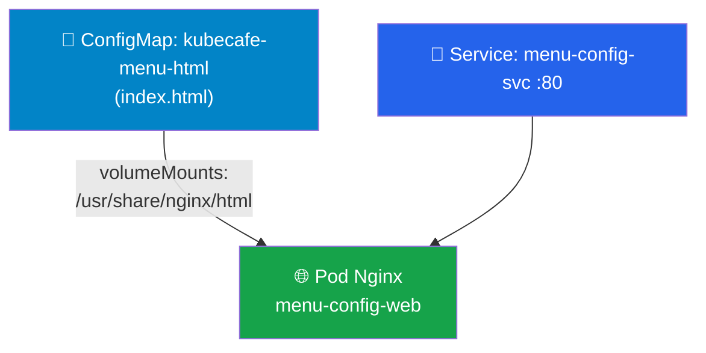
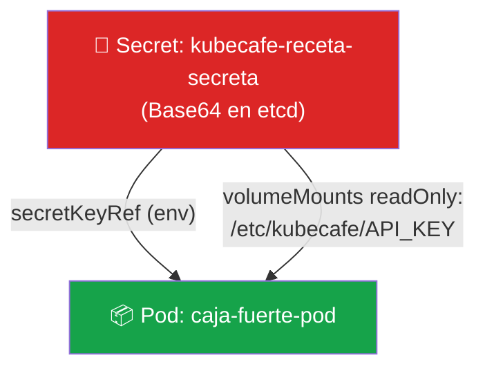
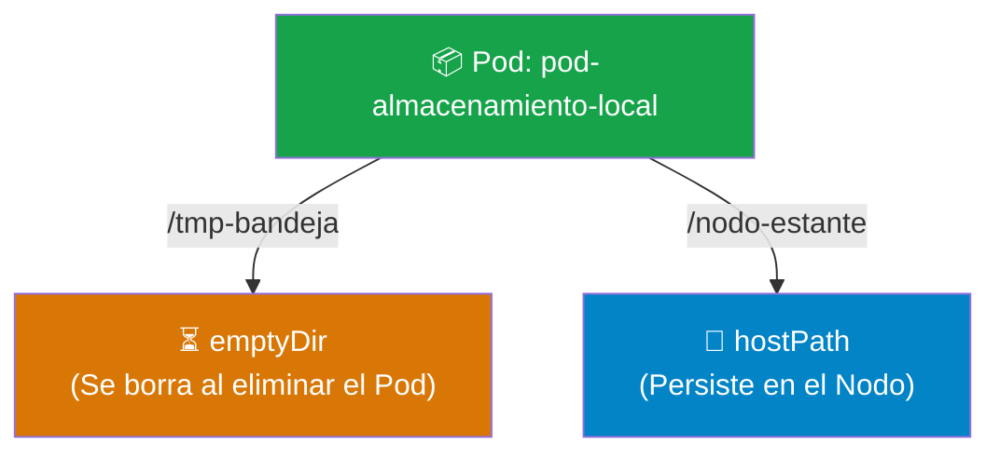
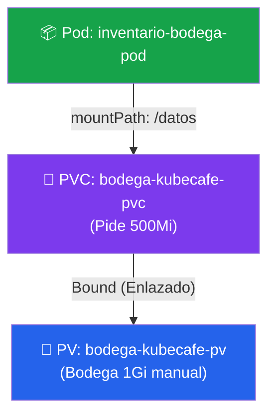
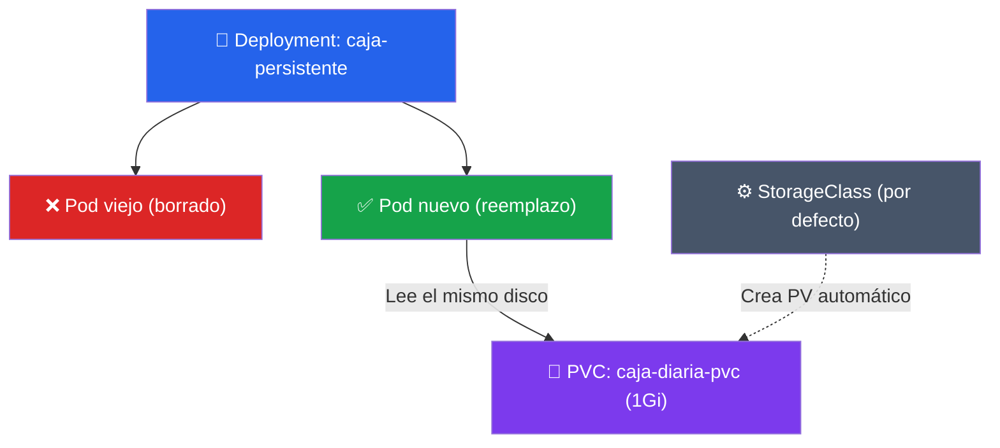

# 🧪 Ejemplos Prácticos de la Semana 04: ConfigMaps, Secrets y Almacenamiento

¡Bienvenido a los laboratorios de la **Semana 04**!  
Esta guía está pensada paso a paso para que cualquier persona —incluso si es tu primera vez con Kubernetes— entienda **qué hace cada comando**, **qué debería responder la terminal** y **por qué ocurre**.

---

## 📦 Paso 0: Prepara tu Entorno (Clonar y Ruta de Trabajo)

Todos los comandos de esta semana se ejecutan desde la **raíz del repositorio (`Fundamentos-Kubernetes`)**:

```bash
# 1. Clonar el repositorio oficial (si aún no lo tienes)
git clone https://github.com/edwinbermudez91/Fundamentos-Kubernetes.git 2>/dev/null || true

# 2. Entrar a la raíz del repositorio y traer los últimos cambios
cd Fundamentos-Kubernetes
git pull origin main
```

---

## 📑 Índice de Ejemplos

| Manifiesto | Concepto Clave | Equivalente en ☕ KubeCafé |
| :--- | :--- | :--- |
| [`01-configmap-variables-entorno.yaml`](./01-configmap-variables-entorno.yaml) | `ConfigMap` con `envFrom` | Tablero de precios inyectado al barista al abrir turno. |
| [`02-configmap-volumen-archivo.yaml`](./02-configmap-volumen-archivo.yaml) | `ConfigMap` montado como archivo | Carta HTML colgada en Nginx sin reconstruir la imagen. |
| [`03-secret-credenciales.yaml`](./03-secret-credenciales.yaml) | `Secret` (`env` + volumen `readOnly`) | Clave de caja fuerte y API Key en bóveda protegida. |
| [`04-volumen-emptydir-vs-hostpath.yaml`](./04-volumen-emptydir-vs-hostpath.yaml) | `emptyDir` vs `hostPath` | Bandeja temporal en barra vs estante fijo del nodo. |
| [`05-pv-pvc-almacenamiento-persistente.yaml`](./05-pv-pvc-almacenamiento-persistente.yaml) | `PV` + `PVC` (`manual`) | Bodega física (`PV`) reservada mediante contrato (`PVC`). |
| [`06-storageclass-dinamico-stateful.yaml`](./06-storageclass-dinamico-stateful.yaml) | `PVC` dinámico + `Deployment` | Caja registradora cuyos registros sobreviven al borrar el Pod. |

---

## 🧂 Laboratorio 1: `ConfigMap` como Variables de Entorno

### 💡 ¿Qué aprenderás?
En lugar de escribir configuraciones fijas dentro del código o la imagen Docker (como el precio del tinto o la moneda), las guardamos aparte en un **`ConfigMap`** y se las pasamos al contenedor como **variables de entorno** (`envFrom`).

### Paso 1: Aplica el manifiesto y espera a que el Pod arranque
```bash
kubectl apply -f semana-04-configuracion-almacenamiento/1.ejemplos/01-configmap-variables-entorno.yaml
kubectl wait --for=condition=ready pod/barista-config-env --timeout=60s
```
> 💡 **Respuesta esperada:**
> ```text
> configmap/kubecafe-config created
> pod/barista-config-env created
> pod/barista-config-env condition met
> ```

### Paso 2: Lista y accede al contenido del `ConfigMap`
```bash
# Listar todos los ConfigMaps del namespace (forma corta: cm)
kubectl get configmaps
kubectl get cm

# Ver detalles y claves del ConfigMap
kubectl describe configmap kubecafe-config

# Acceder al contenido completo en formato YAML
kubectl get configmap kubecafe-config -o yaml
```
> 💡 **Respuesta esperada (`describe` / `-o yaml`):** Verás las 4 claves definidas en `data`: `NOMBRE_LOCAL`, `MONEDA`, `PRECIO_TINTO` y `MODO_DEBUG`.

### Paso 3: Inspecciona el Pod con `describe`, `logs` y `exec`
```bash
# 1. Ver en el Pod que las variables están conectadas al ConfigMap
kubectl describe pod barista-config-env

# 2. Ver la salida impresa al iniciar el contenedor
kubectl logs barista-config-env

# 3. Validar las variables directamente dentro del contenedor con exec
kubectl exec barista-config-env -- env | grep -E "NOMBRE_LOCAL|MONEDA|PRECIO_TINTO|MODO_DEBUG"

# (Opcional) Entrar en modo interactivo al contenedor y consultarlas manualmente
kubectl exec -it barista-config-env -- sh
# Dentro del Pod ejecuta: echo "$NOMBRE_LOCAL | $MONEDA | $PRECIO_TINTO" && exit
```
> 💡 **Respuesta esperada:**
> - En `kubectl describe pod barista-config-env` verás la sección `Environment Variables from: kubecafe-config ConfigMap`.
> - En `kubectl logs` y `kubectl exec` confirmarás los valores reales dentro del contenedor:
> ```text
> NOMBRE_LOCAL=KubeCafé Medellín
> MONEDA=COP
> PRECIO_TINTO=3500
> MODO_DEBUG=false
> ```

---

## 📄 Laboratorio 2: `ConfigMap` montado como Archivo en Nginx

### 💡 ¿Qué aprenderás?
Un `ConfigMap` también puede montarse como un **archivo real** dentro de una carpeta del contenedor (`volumeMounts`). Aquí Nginx sirve su página `index.html` directamente desde un `ConfigMap`, sin necesidad de crear una imagen Docker nueva.



### Paso 1: Despliega Nginx con el `ConfigMap` montado
```bash
kubectl apply -f semana-04-configuracion-almacenamiento/1.ejemplos/02-configmap-volumen-archivo.yaml
kubectl wait --for=condition=ready pod -l app=menu-config-web --timeout=60s
kubectl get pods,svc -l app=menu-config-web
```
> 💡 **Respuesta esperada:**
> ```text
> configmap/kubecafe-menu-html created
> deployment.apps/menu-config-web created
> service/menu-config-svc created
> pod/menu-config-web-... condition met
> ```

### Paso 2: Comprueba el archivo montado (`exec`) y la página web servida por Nginx
```bash
# Verificar el archivo montado dentro del contenedor
kubectl exec deployment/menu-config-web -- ls -la /usr/share/nginx/html
kubectl exec deployment/menu-config-web -- head -n 10 /usr/share/nginx/html/index.html
```

Abrimos un túnel temporal (`port-forward`) desde tu terminal hacia el servicio en el puerto `8084` y consultamos con `curl`:
```bash
kubectl port-forward svc/menu-config-svc 8084:80 >/tmp/pf-8084.log 2>&1 &
PF_PID=$!
sleep 2
curl -s http://localhost:8084 | grep -E "h1|li"
kill $PF_PID
```
> 💡 **Respuesta esperada:**
> ```html
>       <h1>☕ Menú KubeCafé — Cargado desde ConfigMap</h1>
>         <li>Tinto Campesino — $3.500 COP</li>
>         <li>Espresso Doble — $5.000 COP</li>
>         <li>Capuccino Vainilla — $7.500 COP</li>
> ```
> 📌 **Dato clave:** Si editas el `ConfigMap` (`kubectl edit cm kubecafe-menu-html`), Kubernetes actualiza el archivo dentro del contenedor automáticamente (~60 segundos) sin reiniciar ni reconstruir la imagen.

---

## 🔐 Laboratorio 3: `Secret` para Credenciales Sensibles

### 💡 ¿Qué aprenderás?
Los datos confidenciales (contraseñas, tokens, API Keys) **no** deben ir en `ConfigMaps`, sino en un **`Secret`**. Un `Secret` puede consumirse como variable de entorno (`secretKeyRef`) o montado como archivo de solo lectura (`readOnly: true`).



### Paso 1: Crea el `Secret` y el Pod `caja-fuerte-pod`
```bash
kubectl apply -f semana-04-configuracion-almacenamiento/1.ejemplos/03-secret-credenciales.yaml
kubectl wait --for=condition=ready pod/caja-fuerte-pod --timeout=60s
```
> 💡 **Respuesta esperada:**
> ```text
> secret/kubecafe-receta-secreta created
> pod/caja-fuerte-pod created
> pod/caja-fuerte-pod condition met
> ```

### Paso 2: Lista, accede e inspecciona el `Secret` y el Pod (`describe`, `logs` y `exec`)
```bash
# 1. Listar los Secrets del namespace
kubectl get secrets

# 2. Ver metadatos y claves del Secret (muestra el tamaño en bytes, SIN revelar el valor)
kubectl describe secret kubecafe-receta-secreta

# 3. Ver el Secret completo en YAML (observa los valores codificados en Base64)
kubectl get secret kubecafe-receta-secreta -o yaml

# 4. Decodificar una clave puntual desde la terminal
kubectl get secret kubecafe-receta-secreta -o jsonpath='{.data.DB_PASS}' | base64 -d && echo

# 5. Ver en el Pod de dónde salen sus variables y volúmenes secretos
kubectl describe pod caja-fuerte-pod

# 6. Ver logs y validar variables + archivo secreto dentro del contenedor con exec
kubectl logs caja-fuerte-pod
kubectl exec caja-fuerte-pod -- env | grep -E "DB_USER|DB_PASS"
kubectl exec caja-fuerte-pod -- cat /etc/kubecafe/API_KEY

# 7. Comprobar que el volumen está montado en solo lectura (readOnly: true -> debe fallar)
kubectl exec caja-fuerte-pod -- touch /etc/kubecafe/prueba.txt
```
> 💡 **Respuesta esperada:**
> - En `kubectl describe pod caja-fuerte-pod` verás `Environment:` (`<set to the key 'DB_USER' in secret 'kubecafe-receta-secreta'>`) y `Mounts:` (`/etc/kubecafe from secreto-volumen (ro)`).
> - En `kubectl logs` y `kubectl exec` confirmarás que Kubernetes **decodifica el Secret automáticamente** para el contenedor (`barista_admin` y `kc-live-987654321`), y que `touch` falla con `Read-only file system` porque está protegido contra escritura.
> ⚠️ **Importante para principiantes:** Base64 (`echo -n "TintoSeguro2026!" | base64`) es codificación, **no cifrado**. En repositorios reales nunca subas contraseñas reales en texto plano; usa herramientas como *Sealed Secrets* o *External Secrets*.

---

## ⏳ Laboratorio 4: `emptyDir` (Efímero) vs `hostPath` (Nodo)

### 💡 ¿Qué aprenderás?
Por defecto, si un Pod muere o se borra, todo lo que guardó dentro de su contenedor se pierde. Aquí comparamos dos tipos de volúmenes locales de forma sencilla:
- **`emptyDir`:** Una carpeta temporal que nace vacía cuando arranca el Pod y **desaparece** en cuanto el Pod se borra (sirve como bandeja temporal o caché compartida entre contenedores del mismo Pod).
- **`hostPath`:** Apunta a una carpeta física dentro del nodo (`Worker Node`) donde corre el Pod. **Sobrevive** si borras el Pod en ese mismo nodo, pero si el Pod se mueve a otro nodo distinto ya no verá esos archivos.



### Paso 1: Crea el Pod, inspecciona sus volúmenes (`describe`) y verifica con `exec`
```bash
kubectl apply -f semana-04-configuracion-almacenamiento/1.ejemplos/04-volumen-emptydir-vs-hostpath.yaml
kubectl wait --for=condition=ready pod/pod-almacenamiento-local --timeout=60s

# Ver en el Pod cómo están declarados y montados ambos volúmenes (Volumes / Mounts)
kubectl describe pod pod-almacenamiento-local

# Entrar con exec a revisar las carpetas y los archivos creados
kubectl exec pod-almacenamiento-local -- ls -la /tmp-bandeja /nodo-estante
kubectl exec pod-almacenamiento-local -- sh -c "cat /tmp-bandeja/pedidos.log && echo '---' && cat /nodo-estante/historial.log"
```
> 💡 **Respuesta esperada:** En `describe` verás `EmptyDir` y `HostPath` bajo `Volumes:`. Con `exec` verás **1 fecha** en `/tmp-bandeja/pedidos.log` (`emptyDir`) y **1 fecha** en `/nodo-estante/historial.log` (`hostPath`).

### Paso 2: Borra el Pod, recréalo y observa la diferencia
```bash
kubectl delete pod pod-almacenamiento-local
kubectl apply -f semana-04-configuracion-almacenamiento/1.ejemplos/04-volumen-emptydir-vs-hostpath.yaml
kubectl wait --for=condition=ready pod/pod-almacenamiento-local --timeout=60s
kubectl exec pod-almacenamiento-local -- sh -c "cat /tmp-bandeja/pedidos.log && echo '---' && cat /nodo-estante/historial.log"
```
> 💡 **Respuesta esperada:**
> - `/tmp-bandeja/pedidos.log` (`emptyDir`) tendrá **solo 1 línea nueva** (el dato anterior se perdió al borrar el Pod).
> - `/nodo-estante/historial.log` (`hostPath`) tendrá **2 líneas** (conservó la fecha anterior en el nodo).

---

## 📦 Laboratorio 5: `PersistentVolume` (`PV`) y `PersistentVolumeClaim` (`PVC`)

### 💡 ¿Qué aprenderás?
En producción no usamos `hostPath` directo en cada Pod. Separamos el almacenamiento en dos objetos:
- **`PersistentVolume` (`PV`):** El disco o bodega real disponible en el clúster (`1Gi`).
- **`PersistentVolumeClaim` (`PVC`):** La solicitud o "ticket de reserva" de un Pod pidiendo espacio (`500Mi`).



### Paso 1: Crea el `PV`, el `PVC` y el Pod que los usa
```bash
kubectl apply -f semana-04-configuracion-almacenamiento/1.ejemplos/05-pv-pvc-almacenamiento-persistente.yaml

# 1. Listar PV y PVC y comprobar que estén en estado Bound
kubectl get pv,pvc
kubectl describe pvc bodega-kubecafe-pvc

# 2. Esperar al Pod, revisar su montaje con describe y validar el disco con exec
kubectl wait --for=condition=ready pod/inventario-bodega-pod --timeout=60s
kubectl describe pod inventario-bodega-pod
kubectl logs inventario-bodega-pod
kubectl exec inventario-bodega-pod -- ls -la /datos
```
> 💡 **Respuesta esperada en `kubectl get pv,pvc`:**
> ```text
> NAME                                  CAPACITY   ACCESS MODES   RECLAIM POLICY   STATUS   CLAIM                        STORAGECLASS
> persistentvolume/bodega-kubecafe-pv   1Gi        RWO            Retain           Bound    default/bodega-kubecafe-pvc  manual
>
> NAME                                       STATUS   VOLUME               CAPACITY   ACCESS MODES   STORAGECLASS
> persistentvolumeclaim/bodega-kubecafe-pvc  Bound    bodega-kubecafe-pv   1Gi        RWO            manual
> ```
> 📌 **Observa:** Cuando `STATUS` dice **`Bound`**, significa que Kubernetes encontró una bodega (`PV`) compatible y la conectó exitosamente a tu solicitud (`PVC`).

---

## 🔄 Laboratorio 6: `StorageClass` Dinámico y Prueba de Persistencia ante Caídas

### 💡 ¿Qué aprenderás?
Crear un `PV` manual para cada aplicación es poco práctico en clústeres grandes. Con un **`StorageClass`**, basta con crear un `PVC` y el clúster **fabrica automáticamente el `PV`** por ti (aprovisionamiento dinámico).



### Paso 1: Verifica el `StorageClass` de tu clúster y despliega la app
```bash
# 1. Ver qué StorageClass trae tu clúster (en Kind suele llamarse 'standard', en K3s 'local-path'):
kubectl get storageclass

# 2. Aplicar el PVC dinámico y el Deployment:
kubectl apply -f semana-04-configuracion-almacenamiento/1.ejemplos/06-storageclass-dinamico-stateful.yaml
kubectl wait --for=condition=available deployment/caja-persistente --timeout=90s

# 3. Ver el PVC enlazado, el PV creado automáticamente y validar con logs/exec:
kubectl get pvc,pv
kubectl describe pod -l app=caja-persistente
kubectl logs deployment/caja-persistente
kubectl exec deployment/caja-persistente -- cat /var/lib/kubecafe/ventas.log
```
> 💡 **Respuesta esperada:**
> - `caja-diaria-pvc` aparecerá en estado **`Bound`** (el clúster creó el `PV` automáticamente).
> - `kubectl logs` mostrará **1 línea** con el nombre del Pod actual:
>   `Inicio de Pod caja-persistente-xxxxx en ...`

### Paso 2: Simula una caída borrando el Pod y verifica que los datos sobreviven
```bash
# 1. Borra el Pod actual (el Deployment creará uno nuevo automáticamente con otro nombre):
kubectl delete pod -l app=caja-persistente

# 2. Espera a que el nuevo Pod esté listo y revisa los logs:
kubectl wait --for=condition=ready pod -l app=caja-persistente --timeout=60s
kubectl logs deployment/caja-persistente
```
> 💡 **Respuesta esperada:**
> Verás **2 líneas** en `ventas.log` con los nombres de **ambos Pods** (el Pod viejo eliminado y el Pod nuevo):
> ```text
> Inicio de Pod caja-persistente-aaaaa en ...
> Inicio de Pod caja-persistente-bbbbb en ...
> ```
> ¡Acabas de comprobar que tu información sobrevivió a la destrucción del Pod gracias al `PVC`!

---

## 🧹 Limpieza de los Ejemplos

Cuando termines tus pruebas, limpia todos los recursos creados esta semana:

```bash
kubectl delete -f semana-04-configuracion-almacenamiento/1.ejemplos/06-storageclass-dinamico-stateful.yaml --ignore-not-found
kubectl delete -f semana-04-configuracion-almacenamiento/1.ejemplos/05-pv-pvc-almacenamiento-persistente.yaml --ignore-not-found
kubectl delete -f semana-04-configuracion-almacenamiento/1.ejemplos/04-volumen-emptydir-vs-hostpath.yaml --ignore-not-found
kubectl delete -f semana-04-configuracion-almacenamiento/1.ejemplos/03-secret-credenciales.yaml --ignore-not-found
kubectl delete -f semana-04-configuracion-almacenamiento/1.ejemplos/02-configmap-volumen-archivo.yaml --ignore-not-found
kubectl delete -f semana-04-configuracion-almacenamiento/1.ejemplos/01-configmap-variables-entorno.yaml --ignore-not-found
```
